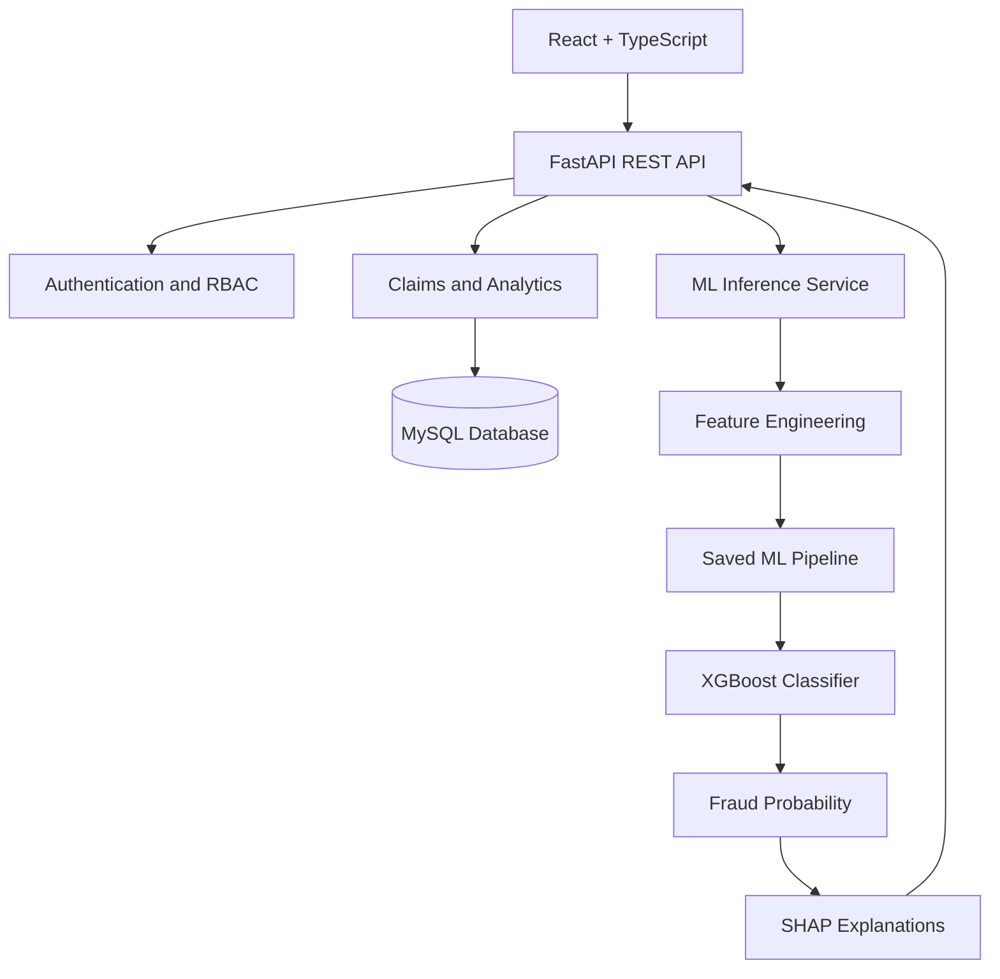

# Insurance Fraud & Risk Intelligence Platform

An end-to-end machine learning platform for insurance fraud detection, explainable risk scoring, and investigation management.

<p align="center">
  
  
  
  
  
  
  
</p>

## Overview

An AI-powered insurance risk intelligence platform that identifies potentially fraudulent claims using a tuned XGBoost model and explains predictions through SHAP. Built with FastAPI, React, TypeScript, and MySQL, it provides claim-level risk assessment, batch prediction, interactive analytics, secure role-based access, and investigation case management.

## Key Features

- **Fraud Detection:** XGBoost-based classification for identifying suspicious insurance claims.
- **Explainable AI:** SHAP-based risk factors and human-readable prediction explanations.
- **Risk Scoring:** Probability-based classification into low-, medium-, and high-risk categories.
- **Batch Prediction:** Process multiple claims through CSV-based inference.
- **Claims Intelligence:** Search, filter, paginate, and inspect claim records.
- **Analytics Dashboard:** Visualize risk distributions, key metrics, and high-risk claims.
- **Investigation Management:** Track cases, update statuses, and maintain investigation notes.
- **Authentication & RBAC:** JWT-based authentication with role-based access control.
- **Relational Database:** MySQL-backed storage for claims, policies, predictions, and investigations.

## Architecture



## Machine Learning Pipeline

### Engineered Features

The model uses eight engineered features:

| Feature | Description |
|---|---|
| `Days_Policy_Accident_Numeric` | Encoded policy-to-accident timing |
| `Days_Policy_Claim_Numeric` | Encoded policy-to-claim timing |
| `Claim_Accident_Delay` | Derived claim and accident timing interval |
| `Previous_Claims_Count` | Encoded previous-claim information |
| `Vehicle_Age_Numeric` | Numeric vehicle age |
| `Vehicle_Price_Numeric` | Numeric vehicle price |
| `No_Police_Report` | Missing police report indicator |
| `No_Witness` | Absence of witnesses indicator |

### Model Workflow

1. Transform raw claim attributes into model-ready features.
2. Apply preprocessing and SMOTE-based class-imbalance handling during training.
3. Generate fraud probabilities using XGBoost.
4. Apply the configured classification threshold and risk bands.
5. Generate SHAP explanations for supported predictions.
6. Return risk assessments and explanations through the API.

### Risk Classification

| Risk Level | Probability | Recommended Action |
|---|---|---|
| Low | Below 0.30 | Standard processing |
| Medium | 0.30 to below 0.60 | Enhanced review |
| High | 0.60 or above | Priority investigation |

**Classification threshold:** `0.10` — configured for recall-oriented screening.

The classification threshold and risk-category boundaries serve different purposes. Final thresholds should be validated against false-positive rates, fraud prevalence, and investigation capacity. Predictions support investigation and do not establish fraud on their own.

### Explainability with SHAP

Each supported prediction includes the leading risk-contributing and protective factors, alongside human-readable analyst notes. SHAP explanations help investigators understand model behavior and prioritize further review.

## API Reference

| Method | Endpoint | Description |
|---|---|---|
| GET | `/` | Health check |
| POST | `/auth/login` | Authenticate and obtain JWT |
| GET | `/auth/me` | Retrieve current user |
| POST | `/auth/logout` | Logout |
| GET | `/model/info` | Retrieve model metadata |
| POST | `/predict` | Predict a single claim |
| POST | `/predict/batch` | Batch CSV prediction |
| GET | `/claims` | Paginated claims listing |
| GET | `/claims/search` | Search claims |
| GET | `/claims/{claim_index}` | Retrieve claim details |
| GET | `/analytics/summary` | Dashboard summary |
| GET | `/analytics/risk-dist` | Risk distribution |
| GET | `/analytics/top-risk` | Highest-risk claims |

Interactive API documentation is available at `/docs` when the backend is running.

## Frontend Pages

| Page | Route | Functionality |
|---|---|---|
| Login | `/login` | User authentication |
| Dashboard | `/` | KPIs, risk charts, and model information |
| Claims | `/claims` | Searchable, filterable claims table |
| Claim Details | `/claims/:id` | Claim attributes and SHAP explanations |
| Search | `/search` | Multi-field claim search |
| Analytics | `/analytics` | Risk and model visualizations |
| Investigations | `/investigations` | Case tracking and investigation notes |

## Technology Stack

**Machine Learning:** Python, pandas, scikit-learn, XGBoost, imbalanced-learn, SHAP, joblib

**Backend:** FastAPI, Uvicorn, python-jose, passlib, JWT, bcrypt

**Frontend:** React 18, TypeScript, Vite, Tailwind CSS, React Query, Recharts, Axios, React Router

**Database:** MySQL, SQL

**Development Tools:** Jupyter Notebook, VS Code, XAMPP

## Project Structure

```text
insurance_fraud/
├── insurance_fraud.ipynb
├── backend/
│   ├── main.py
│   ├── ml_service.py
│   └── requirements.txt
├── frontend/
│   ├── src/
│   │   ├── components/
│   │   ├── pages/
│   │   ├── hooks/useApi.ts
│   │   ├── services/api.ts
│   │   └── types/api.ts
│   ├── package.json
│   └── vite.config.ts
├── database/
│   └── insurance_fraud_db.sql
└── saved_models/
    ├── insurance_fraud_model.pkl
    ├── model_metadata.pkl
    └── insurance_fraud_predictions.csv
```

## Getting Started

### Prerequisites

- Python 3.10+
- Node.js and npm
- MySQL Server or XAMPP
- Git

### 1. Clone the Repository

```bash
git clone <your-repository-url>
cd insurance_fraud
```

### 2. Set Up the Database

1. Open XAMPP Control Panel.
2. Start MySQL.
3. Open PowerShell in VS Code and import the SQL schema:

```powershell
Get-Content "C:\Users\user\Desktop\insurance_fraud\database\insurance_fraud_db.sql" | & "C:\xampp\mysql\bin\mysql.exe" -u root
```

The command assumes the project is located at the specified Windows path and that MySQL uses the default empty root password. Adjust the path or credentials if necessary.

The schema initializes the `insurance_fraud_db` database with the following tables:

| Table | Purpose |
|---|---|
| `users` | User accounts and roles |
| `policyholders` | Policyholder information |
| `vehicles` | Vehicle records |
| `policies` | Insurance policy information |
| `claims` | Filed insurance claims |
| `fraud_predictions` | Model predictions |
| `investigations` | Investigation records |
| `model_metadata` | Model configuration and metrics |

### 3. Configure and Run the Backend

```bash
cd backend
python -m venv venv
```

Activate the environment on Windows:

```powershell
.\venv\Scripts\Activate.ps1
```

Install dependencies and launch the API:

```bash
pip install -r requirements.txt
uvicorn main:app --reload --port 8000
```

Backend: `http://localhost:8000`

API documentation: `http://localhost:8000/docs`

Configure database credentials and other environment-specific settings as required by the backend.

### 4. Run the Frontend

Open a separate terminal:

```bash
cd frontend
npm install
npm run dev
```

Frontend: `http://localhost:3000`

If Vite uses a different port by default, configure `vite.config.ts` accordingly.

Ensure the frontend API proxy targets `http://localhost:8000`.

## Demo Credentials

The following credentials are provided for local demonstration, subject to the configured database seed data.

| Role | Username | Password |
|---|---|---|
| Administrator | `admin` | `admin123` |
| Analyst | `analyst` | `analyst123` |
| Investigator | `investigator` | `invest123` |

**Security notice:** Demo credentials are for local development only. Replace default passwords, use environment variables for secrets, and enforce appropriate authorization policies before deployment.

## Model Artifacts

| Artifact | Description |
|---|---|
| `insurance_fraud_model.pkl` | Serialized preprocessing, imbalance-handling, and XGBoost pipeline |
| `model_metadata.pkl` | Model configuration, feature metadata, risk bands, and available metrics |
| `insurance_fraud_predictions.csv` | Test-set predictions for 3,084 claims |

The saved model artifacts must be compatible with the installed Python and ML library versions. Only load trusted serialized model files.

## Evaluation and Responsible Use

Fraud detection is an imbalanced classification problem where accuracy alone may be misleading. Model evaluation should include precision, recall, F1-score, PR-AUC, confusion matrices, and probability calibration where appropriate.

The platform is designed to support analyst decision-making, not automatically reject claims or accuse policyholders of fraud. Production deployment requires validation on representative data, privacy controls, access auditing, monitoring for model drift, and appropriate human review.

---

**Built with Python, XGBoost, SHAP, FastAPI, React, TypeScript, and MySQL.**